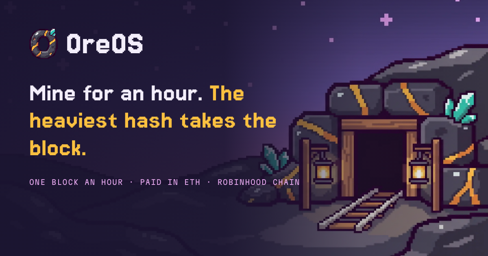
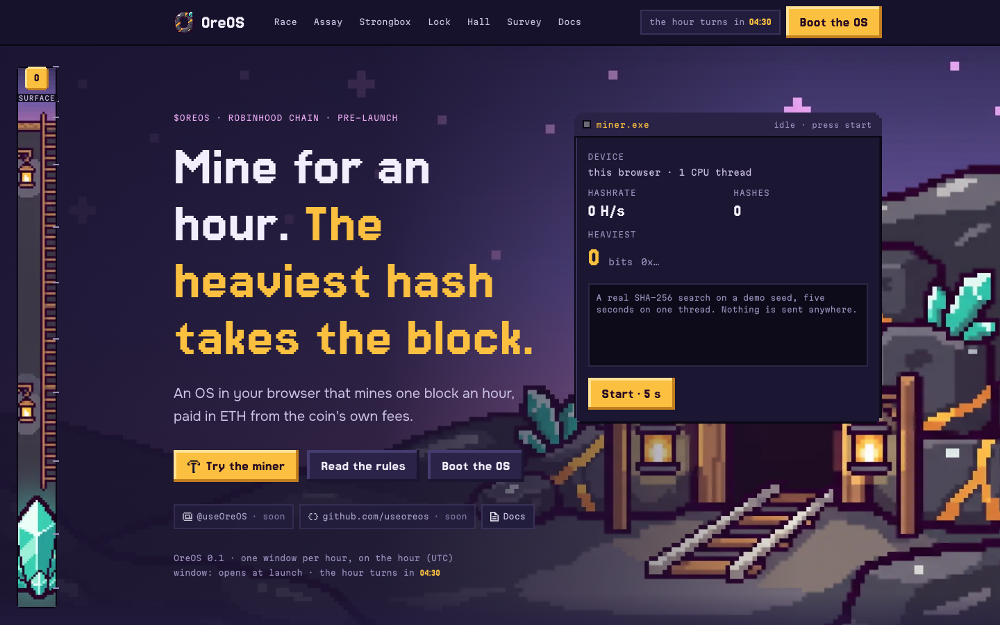
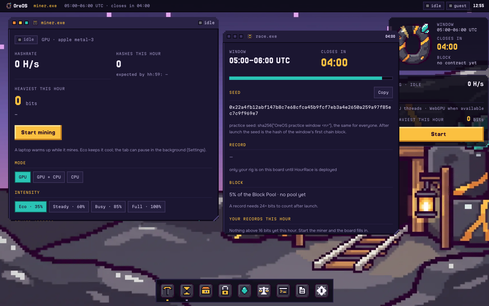
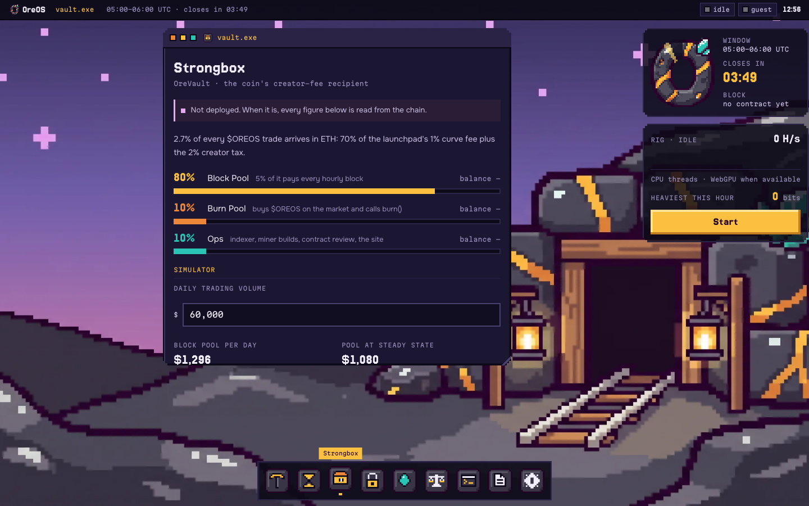
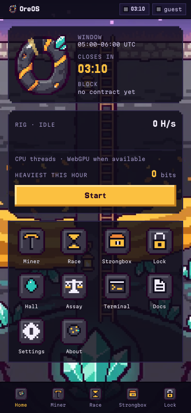
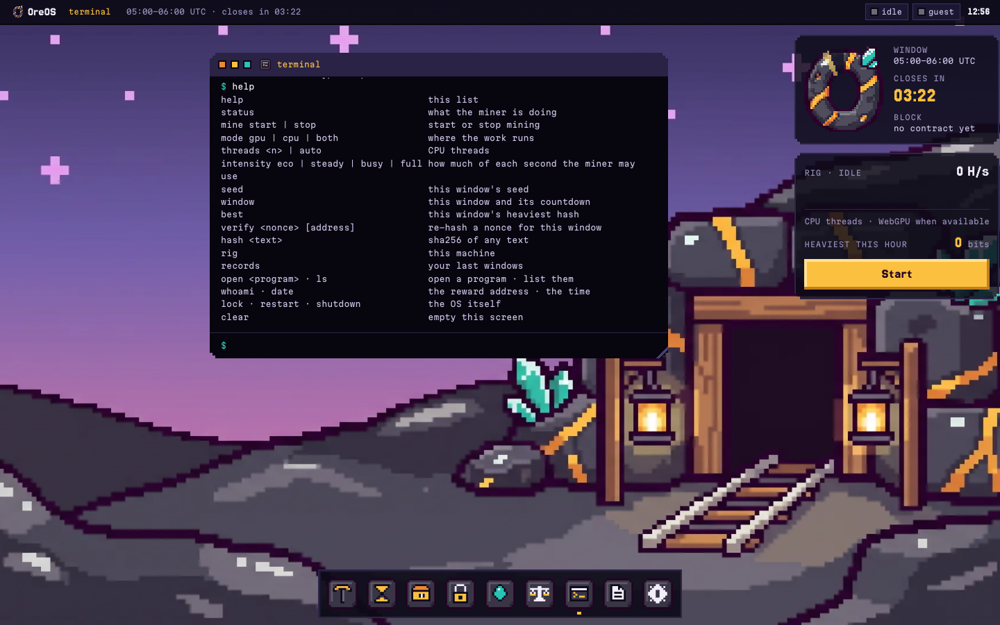
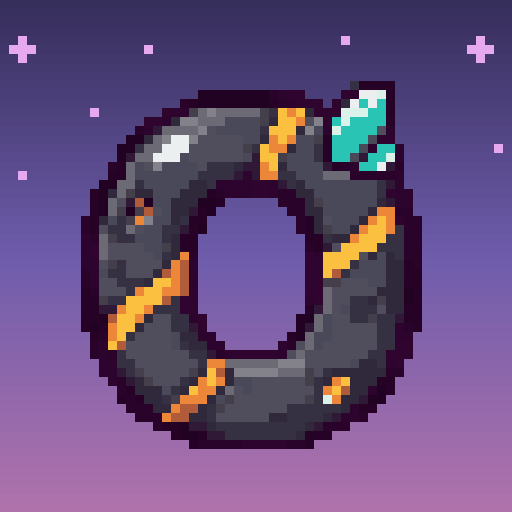

# OreOS

### Mine for an hour. The heaviest hash takes the block.

An operating system in your browser that mines one block an hour on Robinhood Chain, paid in ETH from the coin's own trading fees.

[Website](https://oreos.dev) · [The OS](https://os.oreos.dev) · [Docs](https://oreos.dev/docs)

 

  

---

## ⛏️ What is OreOS

Browser mining always ends the same way. You leave a tab open, a counter climbs, and the credits never leave the app that printed them.

OreOS pays in ETH instead. Every hour a new window opens. Browser tabs, phones and native rigs search for the hash with the most leading zero bits. At the top of the hour the heaviest hash takes the block: **5% of the Block Pool, in ETH, straight to the miner's wallet.**

The pool is filled by the creator fee of **$OREOS**, about **2.7% of every trade**, which a contract splits **80 / 10 / 10** between blocks, burns and ops. The contract recomputes every hash itself. No database decides who earned what, and no block mints new supply.

> [!NOTE]
> **Practice build.** No coin and no contracts are deployed yet. The OS runs a real SHA-256 miner today against a public practice seed per hour, `sha256("OreOS practice window <n>")`. Everything you mine stays in your browser. Submitting, the vault, locks and the network record board open when the contracts go live.

---

## ⏱️ How the race works

| Step | What happens |
|---|---|
| **1. Trade** | About 2.7% of every $OREOS trade reaches the OreOS Vault in ETH: 70% of the 1% curve fee plus a 2% creator tax. |
| **2. Split** | Every pull splits 80% Block Pool, 10% Burn Pool, 10% Ops, in one transaction. |
| **3. Window** | A window opens at hh:00 UTC. Its seed is the hash of the window's first chain block, so nobody can mine it early. |
| **4. Mine** | Miners hash `sha256(seed ‖ rewardTo ‖ window ‖ pad ‖ nonce)`. Weight = leading zero bits + lock bonus bits. |
| **5. Record** | A miner who beats the record submits it. The contract re-hashes it and keeps it only if it is heavier. |
| **6. Settle** | After hh:59:59 the record holder receives 5% of the Block Pool. The settler receives 1% of that block. |

**Rules that keep it fair**

- **Heaviest, not first.** No difficulty to retune. More miners push the record deeper, and the hour stays one hour.
- **The reward address is inside the hash.** A copied nonce still pays the address it was found for.
- **24-bit floor.** A weaker record does not count, and that hour's block stays in the pool.
- **Ties never stand.** On equal weight, the smaller 256-bit value is heavier.
- **No owner, no pause.** The race contract's parameters are constants.

### How heavy is a hash

| Zero bits | One in | Expected best in one hour |
|---|---|---|
| 24 | 16.8 million | the floor a record needs |
| 32 | 4.3 billion | |
| 40 | 1.1 trillion | |
| 43 | | a gaming GPU in a browser tab, ~2 GH/s |
| 46 | | a top GPU on the native miner, ~20 GH/s |
| 48 | 281 trillion | |
| 51 | | the whole network at 500 GH/s |

### Lock-to-boost

| Tier | Locked $OREOS | Bonus | Same as |
|---|---|---|---|
| Visitor | none | +0 bits | base weight |
| Prospector | 1,000,000+ | +1 bit | 2× your hashrate |
| Foreman | 5,000,000+ | +2 bits | 4× your hashrate |
| Engineer | 20,000,000+ | +3 bits | 8× your hashrate |

A lock counts from the next window after it lands, lasts at least 7 days, and frees the coins 7 days after an unlock request. Coins weigh hashes, they never replace them. **No hashes, no block.**

---

## 🖥️ The OS

  

A desktop that boots in a browser tab, at [os.oreos.dev](https://os.oreos.dev).

**Boot and session**

- A power-on sequence with the O logo ring, filled by real checks: clock and window, CPU threads, the SHA-256 core against known answers, the race contract status.
- A boot options menu: GPU and CPU rig, GPU only, CPU only ("cool and quiet"), or a full rig self-test.
- Sign in with a browser wallet (read only, never asked to sign), a typed address, or as a guest mining for the zero address.
- Lock screen, restart and shut down. Arriving from the landing page skips the power-on.

**Desktop**

- Draggable, resizable windows with three lamps (close, tuck, fill), a dock and a top bar.
- Widgets: the hour (an O ring that fills once per hour) and the rig (live hashrate).
- A phone layout under 820 px: a home screen and a tab bar, one program full screen at a time.

**Programs**

| Program | What it does |
|---|---|
| `miner.exe` | Start and stop mining. Mode (GPU, GPU + CPU, CPU), threads, intensity (Eco 35%, Steady 60%, Busy 85%, Full 100%), hashrate, hashes this hour, heaviest this hour, expected best by hh:59, and a log. |
| `race.exe` | The current window, its countdown and seed, your records this hour and your last windows. |
| `vault.exe` | The Strongbox: the 80 / 10 / 10 split, where the fee comes from, and a simulator that turns a daily volume into pool size, block size and burns. |
| `lock.exe` | The four tiers, and what your heaviest hash this hour would weigh at each one. |
| `hall.exe` | Your heaviest hash ever, totals for this browser, and practice marks. |
| `assay.exe` | A calculator: your hashrate, bonus bits and everyone else's hashrate in; your expected heaviest hash, share of the hour and blocks per day out. |
| `terminal` | A shell with 22 commands, including `mine`, `mode`, `intensity`, `seed`, `best`, `verify <nonce>`, `hash <text>`, `rig` and `records`. |
| `docs.txt` | The full manual, inside the OS. |
| `settings` | Rig (threads, memory, WebGPU, CPU and GPU self-tests), miner, boot, desktop and data. |

<table>
  <tr>
    <td width="68%"></td>
    <td width="32%"></td>
  </tr>
</table>

**Practice marks**, checked from your own records: Over the floor (24+ bits), Deep Vein (40+ bits), Full Shift (50+ minutes in one window), Night Shift (00:00 to 06:00 UTC), Three in a Row, Trillion Club (10¹² hashes).

---

## ⚙️ The miner

  

- **WebGPU kernel** written in WGSL, built around the midstate. The first 64 bytes of the 72-byte message never change during a window, so each try costs one SHA-256 compression.
- **CPU fallback**: a pool of Web Workers when the browser has no WebGPU.
- **Every reported hash is checked twice.** Each find from a worker or the GPU is hashed again on the main thread before it counts. One mismatch switches the GPU off.
- **Intensity is a duty cycle**, so the tab stays usable at any setting, and mining can pause while the tab is in the background.
- **Verified against a reference SHA-256** on 12,203 digests.
- Rolls over to the new seed at hh:00 by itself.

Measured in headless Chromium on an Apple M3: about 1.0 GH/s on the GPU at full intensity, 320 to 355 MH/s at Eco, and 3.4 to 3.8 MH/s per CPU thread. Safari has no WebGPU yet, so it mines on CPU threads.

---

## 🪨 The landing page

[oreos.dev](https://oreos.dev) is built as a descent into a mine. Depth is measured in zero bits, from the surface (0) to the fault lines (53), with a ladder rail and a gold marker that follows the scroll.

- **A real miner in the hero.** `miner.exe` runs a genuine SHA-256 search over the OreOS message for 5 seconds on one CPU thread, only when you press it.
- **A working assay calculator** that uses the same formulas as the rules.
- A live countdown to the next UTC hour, and a sample race board, labelled as a sample.
- A first-visit boot screen with five real checks, skippable at once, and a hand-over animation into the OS.
- Sections: Claim, Slag, Race, Assay, Strongbox, Lock, Rigs, Hall, Survey, Faults.
- [/docs](https://oreos.dev/docs): the full manual as a readable page.

---

## 🧱 Tech stack

| Part | Stack |
|---|---|
| Framework | Next.js 16, React 19, TypeScript |
| Styling | Tailwind CSS 4 |
| Mining | WGSL compute shader (WebGPU), Web Workers, a TypeScript SHA-256 for re-checks |
| Fonts | Jersey 15, Onest, Martian Mono |
| Runtime | Docker, non-root user, healthcheck |

The server holds no key and calls nothing. Every page is prerendered, and all mining runs in the visitor's browser.

---

## 🗺️ Roadmap

| Phase | Scope |
|---|---|
| **1 · MVP** | HourRace, OreVault and OreLock tested over 200 simulated windows on a fork. Browser miner, native miner v0.1 (CUDA), the full OS, an indexer and a public read-only API. |
| **2 · Growth** | Tab Pool (pooled browser miners, paid per share), native miner on Metal and OpenCL, badges, seasons, block cards. |
| **3 · Upgrade** | Daily Heavy (a 24-hour window), optional stock blocks, Hall of Weight history. |
| **4 · Ecosystem** | Race Kit: other coins run their own hourly race on the OreOS contracts, and 5% of each partner's Block Pool burns $OREOS. |

---

## ⚠️ Disclaimer

OreOS is experimental software. Mining uses electricity and wears hardware. Blocks depend on trading volume and on everyone else's hashrate: most hours, most miners take nothing. $OREOS is a utility token. A lock adds weight to the hashes of the wallet that holds it, and confers no ownership, profit share or claim on the Vault. OreOS is a community project, not affiliated with, endorsed by or sponsored by Robinhood or any launchpad. Nothing here is financial advice.

 

**One block an hour. Paid in ETH. Mined from a tab.**

